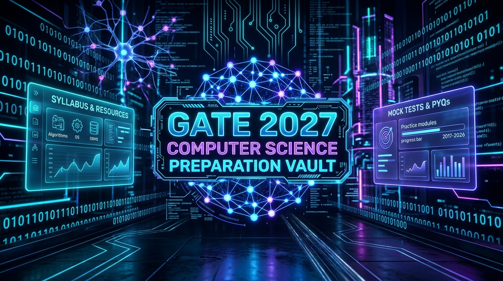
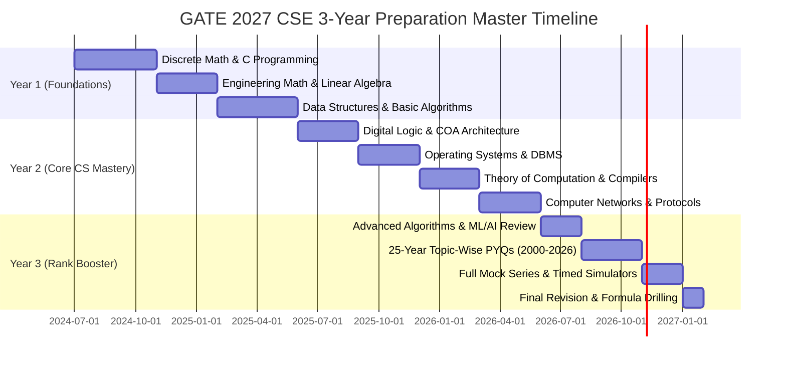

<div align="center">



# 🚀 GATE 2027 Computer Science & IT (CSE) Ultimate Preparation Vault
### 📚 The Complete Free Repository of Standard Textbooks, Topper Handwritten Notes, Mindmaps, PYQs & 3-Year Master Roadmap

[](https://github.com/Techtitan-techy/GATE-2027/stargazers)
[](https://github.com/Techtitan-techy/GATE-2027/network/members)
[](https://github.com/Techtitan-techy/GATE-2027)
[](./SITEMAP.md)
[](./SITEMAP.md)
[](https://gitskins.com)
[](./LICENSE)

<br/>

<p align="center">
  <b>Curated for Computer Science & Engineering (CSE) and Data Science & AI (DA) Aspirants Aiming for IISc, IIT Bombay, IIT Delhi, IIT Madras, IIT Kanpur, IIT Kharagpur, and Premier PSUs.</b>
</p>

[🎯 Exam Pattern & Weightage](#-exam-pattern--marks-distribution) •
[📚 Subject Vault](#-the-master-subject-vault--book-catalog) •
[🗓️ 3-Year Roadmap](#-strategic-3-year-roadmap-for-gate-2027) •
[🧠 Mindmaps](#-visual-mindmaps--handcrafted-cheatsheets) •
[🏆 Topper Notes](#-toppers-handwritten-notes-catalog) •
[🔍 Google SEO & Indexing](#-google-indexing--seo-keyword-matrix) •
[🤝 Contributing](#-contributing--community)

</div>

---

## ⚡ Quick Repository Overview

Welcome to the **GATE 2027 CSE Preparation Vault** — an open, comprehensive, and meticulously organized repository containing everything an engineering student needs to prepare for **GATE 2027 Computer Science & Information Technology**.

* ✅ **12 Modular Subject Directories**: Cleanly partitioned from Mathematics and Core CS to AI/ML.
* ✅ **Standard IIT-Prescribed Textbooks**: Cormen (CLRS), Kenneth Rosen, Silberschatz, Andrew Tanenbaum, James Kurose, B.S. Grewal, Michael Sipser, Patterson & Hennessy, and Russell & Norvig.
* ✅ **Handwritten Toppers' Notes**: Ace Academy, GateNotes, Gradeup, and Sanchit Sir class notes.
* ✅ **Visual Concept Mindmaps**: High-resolution diagrams for fast revision.
* ✅ **Zero Paywalls**: 100% free, decentralized, and accessible.

---

## 🎯 Exam Pattern & Marks Distribution

The Graduate Aptitude Test in Engineering (GATE) for Computer Science is a **3-hour (180 minutes)** computer-based test consisting of **65 questions** for a total of **100 marks**.

```
┌─────────────────────────────────────────────────────────────────────────────┐
│                       GATE CSE TOTAL: 100 MARKS (65 Qs)                     │
├──────────────────────────┬─────────────────────────────┬────────────────────┤
│   GENERAL APTITUDE (GA)  │  ENGINEERING MATH & DM (EM) │   CORE CS & IT     │
│        15 Marks          │         13 - 15 Marks       │   70 - 72 Marks    │
│    (10 Questions)        │        (10 Questions)       │  (45 Questions)    │
└──────────────────────────┴─────────────────────────────┴────────────────────┘
```

### Question Types & Scoring Matrix
| Type | Description | Negative Marking (1 Mark) | Negative Marking (2 Marks) | Strategy Tip |
| :--- | :--- | :---: | :---: | :--- |
| **MCQ** (Multiple Choice) | Single correct option out of 4 | **-0.33** | **-0.66** | Eliminate wrong options; avoid blind guesses |
| **MSQ** (Multiple Select) | One or more correct options | **0** (No negative) | **0** (No negative) | No partial marks! Master theory fundamentals |
| **NAT** (Numerical Answer) | Exact decimal / integer input | **0** (No negative) | **0** (No negative) | Calculate with virtual calculator precision |

> 📌 For the complete syllabus breakdown, refer to [**01 — Official Syllabus & PYQs / GATE_CSE_2027_SYLLABUS.md**](./01%20%E2%80%94%20Official%20Syllabus%20%26%20PYQs/GATE_CSE_2027_SYLLABUS.md).

---

## 📚 The Master Subject Vault & Book Catalog

Below is the directory mapping of all standard reference textbooks and study notes housed in this vault:

### 1. [01 — Official Syllabus & PYQs](./01%20%E2%80%94%20Official%20Syllabus%20%26%20PYQs/)
* **[GATE CSE 2027 Complete Syllabus, Question Types & Marks Weightage](./01%20%E2%80%94%20Official%20Syllabus%20%26%20PYQs/GATE_CSE_2027_SYLLABUS.md)**

---

### 2. [02 — Discrete Mathematics](./02%20%E2%80%94%20Discrete%20Mathematics/)
> **GATE Weightage**: 7 – 9 Marks | **Prerequisite For**: Algorithms, TOC, Compiler Design

| Title / Document | Author / Source | Key Focus Areas |
| :--- | :--- | :--- |
| 📖 [Discrete Mathematics & Its Applications (8th Ed)](./02%20%E2%80%94%20Discrete%20Mathematics/Kenneth%20Rosen%20-%20Discrete%20Mathematics%20and%20Its%20Applications%20-%208th%20edition.pdf) | Kenneth H. Rosen | Propositional & First-Order Logic, Sets, Relations, Functions, Lattices, Combinatorics |
| 📖 [Introduction to Graph Theory](./02%20%E2%80%94%20Discrete%20Mathematics/robinJWilson.pdf) | Robin J. Wilson | Graph Connectivity, Euler & Hamiltonian Graphs, Planarity, Coloring, Trees |
| 📖 [Graph Theory Core Textbook](./02%20%E2%80%94%20Discrete%20Mathematics/graphTheoryTB.pdf) | Standard Text | Isomorphism, Matching, Vertex & Edge Cover, Independent Sets |
| 📝 [Engineering & Discrete Math Formula Guide](./02%20%E2%80%94%20Discrete%20Mathematics/EM_FORMULA_GUIDE.pdf) | Formula Compilation | Rapid formula revision cards for quick problem solving |
| 📝 [Gradeup Discrete Mathematics Notes](./02%20%E2%80%94%20Discrete%20Mathematics/EM_GRADEUP.pdf) | Gradeup / BYJU's Exam Prep | Solved examples and previous year question pattern analysis |
| 🧠 [Propositional Logic Mindmap](./02%20%E2%80%94%20Discrete%20Mathematics/Propositional%20Logic%20GATE%202027%20Mindmap.png) | High-Res Infographic | Visual roadmap of Tautology, Contradiction, Inference Rules & Quantifiers |

---

### 3. [03 — Programming, Data Structures & Algorithms](./03%20%E2%80%94%20Programming%2C%20Data%20Structures%20%26%20Algorithms/)
> **GATE Weightage**: 16 – 20 Marks (Combined) | **Core Foundation of Computer Science**

| Title / Document | Author / Source | Key Focus Areas |
| :--- | :--- | :--- |
| 📖 [Introduction to Algorithms (CLRS Latest Ed)](./03%20%E2%80%94%20Programming%2C%20Data%20Structures%20%26%20Algorithms/Introduction%20to%20Algorithms%20-%20Thomas%20H.%20Cormen%20latest%20edition.pdf) | Cormen, Leiserson, Rivest, Stein | Asymptotic Notation, Divide & Conquer, Dynamic Programming, Greedy, Graph Algorithms, NP-Completeness |
| 📖 [The C Programming Language (2nd Ed)](./03%20%E2%80%94%20Programming%2C%20Data%20Structures%20%26%20Algorithms/The_C_Programming_Language_(2nd_Edition_Ritchie_Kernighan).pdf) | Brian Kernighan & Dennis Ritchie | Pointers, Memory Allocation, Structures, Recursion, Parameter Passing, Bitwise Operations |
| 📖 [Python Crash Course](./03%20%E2%80%94%20Programming%2C%20Data%20Structures%20%26%20Algorithms/Python%20Crash%20Course_%20A%20Hands-On%2C%20Project-Based%20Introduction%20to%20Programming.pdf) | Eric Matthes | Modern Python scripting, fundamental syntax, object-oriented concepts for DA/AI paper |
| 📝 [Data Structures and Algorithms Handbook](./03%20%E2%80%94%20Programming%2C%20Data%20Structures%20%26%20Algorithms/datastructures-and-algorithms.pdf) | CS Handbook | Stacks, Queues, Linked Lists, Binary Trees, BST, AVL Trees, B/B+ Trees, Heaps |
| 📝 [CSE Programming & Problem Solving Lab Manual](./03%20%E2%80%94%20Programming%2C%20Data%20Structures%20%26%20Algorithms/CSE_PPS_LM_BT23.pdf) | Academic Notes | Step-by-step C coding problems and boundary case tracing |

---

### 4. [04 — Theory of Computation](./04%20%E2%80%94%20Theory%20of%20Computation/)
> **GATE Weightage**: 8 – 10 Marks | **Pure Conceptual Scoring Subject**

| Title / Document | Author / Source | Key Focus Areas |
| :--- | :--- | :--- |
| 📖 [Introduction to the Theory of Computation (3rd Ed)](./04%20%E2%80%94%20Theory%20of%20Computation/Introduction%20to%20the%20theory%20of%20computation_third%20edition%20-%20Michael%20Sipser.pdf) | Michael Sipser | Finite Automata (DFA/NFA/NFA-ε), Regular Expressions, CFLs, Pushdown Automata, Turing Machines, Decidability |
| 📝 [GateNotes TOC Handcrafted Class Notes (Part 1)](./04%20%E2%80%94%20Theory%20of%20Computation/1.TOC(www.gatenotes.in).pdf) | GateNotes | State transitions, minimization of DFA, grammar conversions |
| 📝 [GateNotes TOC Handcrafted Class Notes (Part 2)](./04%20%E2%80%94%20Theory%20of%20Computation/2.Theory_of_Computation(www.gatenotes.in).pdf) | GateNotes | Undecidability proofs, Post Correspondence Problem (PCP), Chomsky Hierarchy |

---

### 5. [05 — Compiler Design](./05%20%E2%80%94%20Compiler%20Design/)
> **GATE Weightage**: 4 – 6 Marks | **Direct Extension of Theory of Computation**

| Title / Document | Author / Source | Key Focus Areas |
| :--- | :--- | :--- |
| 📝 [Ace Academy Compiler Design Notes](./05%20%E2%80%94%20Compiler%20Design/3.Ace%20Academy%20Compiler%20Design%20Class%20Notes(www.gatenotes.in).pdf) | Ace Academy Toppers | Lexical Analysis, LL(1) Parsing Table Construction, CLR/LALR Parsers, Conflicts (Shift-Reduce) |
| 📝 [Sanchit Sir Compiler Design Notes](./05%20%E2%80%94%20Compiler%20Design/2.CD%20Sanchit%20Sir%20Notes(www.gatenotes.in).pdf) | Knowledge Gate / Sanchit Jain | Syntax Directed Translation (SDT), S-Attributed vs L-Attributed, Intermediate Code Generation (3-Address Code) |
| 📝 [Compiler Design CS Full Subject Notes](./05%20%E2%80%94%20Compiler%20Design/6.Compiler%20Design-CS(www.gatenotes.in).pdf) | GateNotes | Code Optimization, Basic Blocks, Flow Graphs, Liveness Analysis, Register Allocation |

---

### 6. [06 — Operating Systems](./06%20%E2%80%94%20Operating%20Systems/)
> **GATE Weightage**: 8 – 10 Marks | **High Practical Relevance**

| Title / Document | Author / Source | Key Focus Areas |
| :--- | :--- | :--- |
| 📖 [Operating System Concepts (10th Ed)](./06%20%E2%80%94%20Operating%20Systems/Abraham-Silberschatz-Operating-System-Concepts-10th-2018.pdf) | Silberschatz, Galvin, Gagne | Processes & Threads, CPU Scheduling Algorithms, Semaphores & Synchronization, Deadlock Prevention/Avoidance/Detection |
| 📖 [Modern Operating Systems](./06%20%E2%80%94%20Operating%20Systems/Andrew%20S.%20Tanenbaum%20-%20Modern%20Operating%20Systems.pdf) | Andrew S. Tanenbaum & Herbert Bos | Virtual Memory, Paging, Inverted Page Tables, Multi-level Paging, Disk Scheduling, File Systems |

---

### 7. [07 — Database Management Systems](./07%20%E2%80%94%20Database%20Management%20Systems/)
> **GATE Weightage**: 7 – 9 Marks | **High Return on Investment**

| Title / Document | Author / Source | Key Focus Areas |
| :--- | :--- | :--- |
| 📖 [Database System Concepts (6th Ed)](./07%20%E2%80%94%20Database%20Management%20Systems/Database%20System%20Concepts-6e.pdf) | Silberschatz, Korth, Sudarshan | ER-Modeling, Relational Algebra & Calculus, SQL Queries, Functional Dependencies, Normal Forms (1NF, 2NF, 3NF, BCNF), Serializability, 2PL, Recovery |

---

### 8. [08 — Computer Networks](./08%20%E2%80%94%20Computer%20Networks/)
> **GATE Weightage**: 8 – 10 Marks | **Comprehensive Protocol Study**

| Title / Document | Author / Source | Key Focus Areas |
| :--- | :--- | :--- |
| 📖 [Computer Networking: A Top-Down Approach (8th Global Ed)](./08%20%E2%80%94%20Computer%20Networks/Computer%20Networking_%20A%20Top-Down%20Approach%2C%20Global%20Edition%2C%208th%20Edition.pdf) | James F. Kurose & Keith W. Ross | Application Layer (HTTP, DNS, SMTP), Transport Layer (TCP Flow & Congestion Control, UDP, Window Size calculations) |
| 📖 [TCP/IP Protocol Suite (4th Ed)](./08%20%E2%80%94%20Computer%20Networks/tcp_ip-protocol-suite-4th-ed-b-forouzan-mcgraw-hill-2010-bbs.pdf) | Behrouz A. Forouzan | Network Layer (IPv4/IPv6 Subnetting, CIDR, NAT, Routing Protocols: Distance Vector, Link State, BGP), Data Link Framing & Error Control |

---

### 9. [09 — Digital Logic & Computer Organization](./09%20%E2%80%94%20Digital%20Logic%20%26%20Computer%20Organization/)
> **GATE Weightage**: 11 – 15 Marks (Combined) | **Hardware & Systems Interface**

| Title / Document | Author / Source | Key Focus Areas |
| :--- | :--- | :--- |
| 📖 [Computer Organization and Design: HW/SW Interface (5th Ed)](./09%20%E2%80%94%20Digital%20Logic%20%26%20Computer%20Organization/Computer%20Organization%20and%20Design-%20The%20HW_SW%20Inteface%205th%20edition%20-%20David%20A.%20Patterson%20%26%20John%20L.%20Hennessy.pdf) | David A. Patterson & John L. Hennessy | Instruction Set Architecture, Instruction Pipelining, Data/Control/Structural Hazards, Cache Mapping (Direct, Set-Associative), Secondary Storage |

---

### 10. [10 — Engineering Mathematics & Calculus](./10%20%E2%80%94%20Engineering%20Mathematics%20%26%20Calculus/)
> **GATE Weightage**: 5 – 7 Marks | **The Rank-Decider Section**

| Title / Document | Author / Source | Key Focus Areas |
| :--- | :--- | :--- |
| 📖 [Higher Engineering Mathematics](./10%20%E2%80%94%20Engineering%20Mathematics%20%26%20Calculus/bs%20grewal%20higher%20engineering%20mathematics.pdf) *(Git LFS)* | Dr. B.S. Grewal | Complete Engineering Math reference: Linear Algebra, Differential Calculus, Integral Calculus, Vector Calculus |
| 📖 [Advanced Engineering Mathematics (10th Ed)](./10%20%E2%80%94%20Engineering%20Mathematics%20%26%20Calculus/Advanced%20Engineering%20Mathematics%2010th%20Edition.pdf) | Erwin Kreyszig | Matrix Eigenvalues & Eigenvectors, System of Linear Equations, Differential Equations |
| 📖 [Calculus: Early Transcendentals (8th Ed)](./10%20%E2%80%94%20Engineering%20Mathematics%20%26%20Calculus/calculus_early_transcendentals_james_stewart_8th_edition.pdf) | James Stewart | Limits, Continuity, Differentiability, Mean Value Theorems, Maxima & Minima of Single/Multi-variable functions |
| 📝 [Made Easy Engineering Mathematics Handbook](./10%20%E2%80%94%20Engineering%20Mathematics%20%26%20Calculus/GATE-Mathematics-MM.pdf) | Made Easy | Solved GATE previous year problems with shortcuts and formula tables |

---

### 11. [11 — Probability, Statistics & Linear Algebra](./11%20%E2%80%94%20Probability%2C%20Statistics%20%26%20Linear%20Algebra/)
> **GATE Weightage**: 5 – 8 Marks | **Crucial for both CS and Data Science (DA)**

| Title / Document | Author / Source | Key Focus Areas |
| :--- | :--- | :--- |
| 📝 [Mathematical Foundations of Machine Learning & Statistics](./11%20%E2%80%94%20Probability%2C%20Statistics%20%26%20Linear%20Algebra/ML_GEE_KP.pdf) | Specialized Lecture Notes | Random Variables, Probability Density Functions (Uniform, Exponential, Normal, Poisson), Bayes Theorem, Matrix Factorization |

---

### 12. [12 — Machine Learning & Artificial Intelligence](./12%20%E2%80%94%20Machine%20Learning%20%26%20Artificial%20Intelligence/)
> **Interdisciplinary Focus**: Dual preparation for GATE CS & GATE DA (Data Science & AI)

| Title / Document | Author / Source | Key Focus Areas |
| :--- | :--- | :--- |
| 📖 [Artificial Intelligence: A Modern Approach (AIMA)](./12%20%E2%80%94%20Machine%20Learning%20%26%20Artificial%20Intelligence/Artificial%20Intelligence%20A%20Modern%20Approach%20by%20Stuart%20Russell%20and%20Peter%20Norvig.pdf) | Stuart Russell & Peter Norvig | Search Algorithms (A*, BFS, DFS, Heuristic Search), Adversarial Games (Minimax, Alpha-Beta Pruning), Propositional & FOL Representation |
| 📖 [Pattern Recognition and Machine Learning (PRML)](./12%20%E2%80%94%20Machine%20Learning%20%26%20Artificial%20Intelligence/Bishop-Pattern-Recognition-and-Machine-Learning-2006.pdf) | Christopher M. Bishop | Supervised Learning (Linear Regression, Logistic Regression, SVMs), Unsupervised Learning (K-Means, PCA, GMMs), Neural Networks |

---

## 🗓️ Strategic 3-Year Roadmap for GATE 2027

To score an **AIR < 100**, consistency over time beats last-minute cramming. Here is the structured roadmap:



### Phase Details:
1. **Phase 1 — Mathematical Foundations & Coding**: Focus on Kenneth Rosen and Dennis Ritchie. Solve all textbook end-chapter exercises.
2. **Phase 2 — Core Systems Engineering**: Master Silberschatz (OS & DBMS) and Tanenbaum/Kurose (CN). Focus on numerical problem types (paging math, subnet masking, pipeline throughput).
3. **Phase 3 — Theoretical Depth**: Master Sipser for TOC and LL/LR parser tables for Compiler Design.
4. **Phase 4 — 25-Year PYQ Solving**: Attempt every question from 2000 to 2026. Maintain an **Error Logbook** documenting every mistake.
5. **Phase 5 — Test Series Simulation**: Give 25+ full-length mock tests between 9:00 AM to 12:00 PM or 2:00 PM to 5:00 PM to synchronize circadian rhythm with actual exam slots.

---

## 🧠 Visual Mindmaps & Handcrafted Cheatsheets

Visual memory significantly improves retention for formula-heavy topics. Included in this repository is the high-resolution mindmap:

### Propositional & Predicate Logic (Discrete Mathematics)
> File: [`02 — Discrete Mathematics/Propositional Logic GATE 2027 Mindmap.png`](./02%20%E2%80%94%20Discrete%20Mathematics/Propositional%20Logic%20GATE%202027%20Mindmap.png)

```
                       ┌──────────────────────────────────────────────┐
                       │          PROPOSITIONAL LOGIC (GATE CS)       │
                       └──────────────────────┬───────────────────────┘
                                              │
         ┌───────────────────┬────────────────┴──────────────────┬───────────────────┐
         │                   │                                   │                   │
┌────────┴────────┐ ┌────────┴────────┐                 ┌────────┴────────┐ ┌────────┴────────┐
│ Connectives &   │ │ Normal Forms    │                 │ Inference Rules │ │ First-Order     │
│ Truth Tables    │ │ (CNF, DNF)      │                 │ (Modus Ponens,  │ │ Logic (FOL)     │
│ (∧, ∨, ¬, →, ↔) │ │ Equivalence     │                 │ Resolution)     │ │ Quantifiers     │
└─────────────────┘ └─────────────────┘                 └─────────────────┘ └─────────────────┘
```

---

## 🏆 Toppers' Handwritten Notes Catalog

Why make notes from scratch when you can learn from verified toppers? This vault houses curated notes from premier coaching institutes:

* **Ace Academy Notes**: In-depth theoretical derivations, trick shortcuts, and standard gate pattern classifications.
* **GateNotes Collections**: Concise summary notes ideal for 7-day pre-exam revision.
* **Sanchit Sir (Knowledge Gate) Notes**: Clear diagrams, intuitive step-by-step algorithms, and solved gate problems.
* **Made Easy Mathematics Handbook**: Comprehensive formula bank covering Calculus, Linear Algebra, and Probability.

---

## 🔍 Google Indexing & SEO Keyword Matrix

This repository is optimized for discoverability across search engines (Google, Bing, DuckDuckGo) and developer platforms.

### Search Keyword Index:
* `GATE 2027 CSE Syllabus and Exam Pattern`
* `Best standard reference books for GATE Computer Science`
* `Download Introduction to Algorithms Cormen CLRS PDF for GATE`
* `Kenneth Rosen Discrete Mathematics 8th Edition GATE CS PDF`
* `Silberschatz Operating Systems and Database Systems Concepts free PDF`
* `Kurose Ross Computer Networking Top Down Approach GATE Notes`
* `B.S. Grewal Higher Engineering Mathematics GATE solved examples`
* `Michael Sipser Theory of Computation 3rd Edition download`
* `Patterson Hennessy Computer Organization and Architecture 5th Edition`
* `Ace Academy Made Easy handwritten notes for GATE CS free download`
* `GATE CS 2027 preparation strategy for AIR under 100`
* `3 year preparation roadmap for GATE CSE 2027`

### Schema.org Educational Resource Structured Data
```json
{
  "@context": "https://schema.org",
  "@type": "Course",
  "name": "GATE 2027 Computer Science & Information Technology Preparation Vault",
  "description": "Comprehensive open-access repository of standard textbooks, handwritten topper notes, syllabus guide, and roadmaps for GATE 2027 CSE.",
  "provider": {
    "@type": "Person",
    "name": "Karthikesh",
    "alternateName": "Techtitan-techy",
    "url": "https://github.com/Techtitan-techy"
  },
  "educationalLevel": "Undergraduate / Graduate Engineering",
  "about": [
    "Computer Science",
    "Discrete Mathematics",
    "Algorithms",
    "Operating Systems",
    "Database Management Systems",
    "Computer Networks",
    "GATE 2027"
  ]
}
```

---

## 🛠️ Repository Setup & Git LFS Instructions

To clone this repository and automatically download all large textbook assets (including BS Grewal):

```bash
# 1. Install Git LFS (if not already installed)
git lfs install

# 2. Clone the repository
git clone https://github.com/Techtitan-techy/GATE-2027.git

# 3. Navigate into the repository
cd GATE-2027

# 4. Pull all Git LFS tracked textbook files
git lfs pull
```

---

## 🤝 Contributing & Community

Contributions are welcomed! Whether you have:
* High-yield topper handwritten notes
* Missing standard textbook editions
* New topic mindmaps or cheatsheets
* Previous year question solutions

Please check out our [**CONTRIBUTING.md**](./CONTRIBUTING.md) guide and submit a Pull Request!

---

## 📜 Fair Use & Disclaimer

All textbooks, manuals, and lecture notes in this repository are compiled strictly for **personal non-commercial educational and research purposes** under Fair Use guidelines. If you are a copyright holder and wish for any material to be taken down, please open an issue or reach out directly.

---

<div align="center">

### ⭐ If you find this vault helpful, please star the repository!

[](https://star-history.com/#Techtitan-techy/GATE-2027&Date)

<br/>

Designed with ❤️ for all GATE 2027 Aspirants | Powered by **[GitSkins Aesthetic DNA](https://gitskins.com)**

</div>
